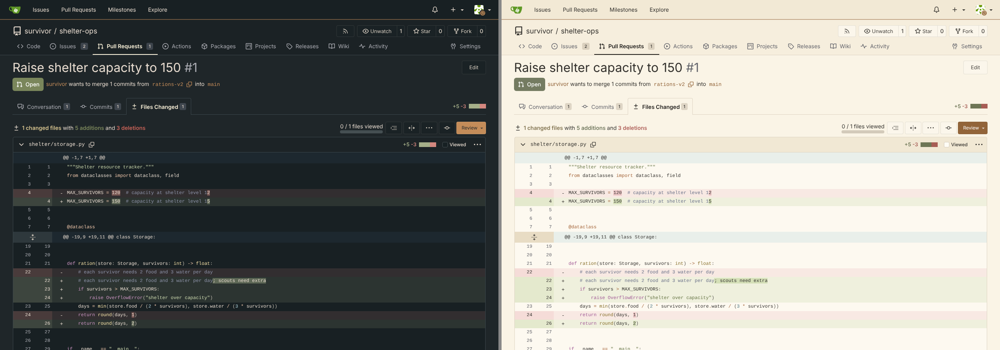
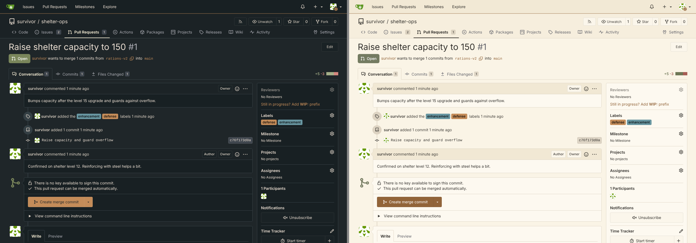
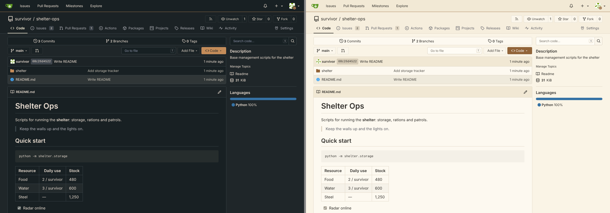

# Dusk Haze Themes for Gitea

Muted, pastel light and dark themes for Gitea, with every color tuned for readable text, diffs, code highlighting and Actions logs.

| Theme | Display name | File name | app.ini ID |
|-------|--------------|-----------|------------|
| Dark | Dusk Haze Night | theme-dusk-haze-night.css | dusk-haze-night |
| Light | Dusk Haze Day | theme-dusk-haze-day.css | dusk-haze-day |
| Auto | Dusk Haze Auto | theme-dusk-haze-auto.css | dusk-haze-auto |

## Install

1. Copy the three CSS files to `$GITEA_CUSTOM/public/assets/css/`.
   On most installs that is `/var/lib/gitea/custom/public/assets/css/`.
2. If `[ui] THEMES` is set in `app.ini`, add the new themes to it:
   ```ini
   [ui]
   THEMES = gitea-auto, gitea-light, gitea-dark, dusk-haze-auto, dusk-haze-day, dusk-haze-night
   DEFAULT_THEME = dusk-haze-auto
   ```
   If `THEMES` is not set, Gitea discovers the files on its own.
3. Restart Gitea, then pick a theme under **Settings → Appearance**.

Every color variable in Gitea's built-in themes is overridden, including diffs, syntax highlighting, Actions log ANSI colors, alerts and badges.

## Previews



